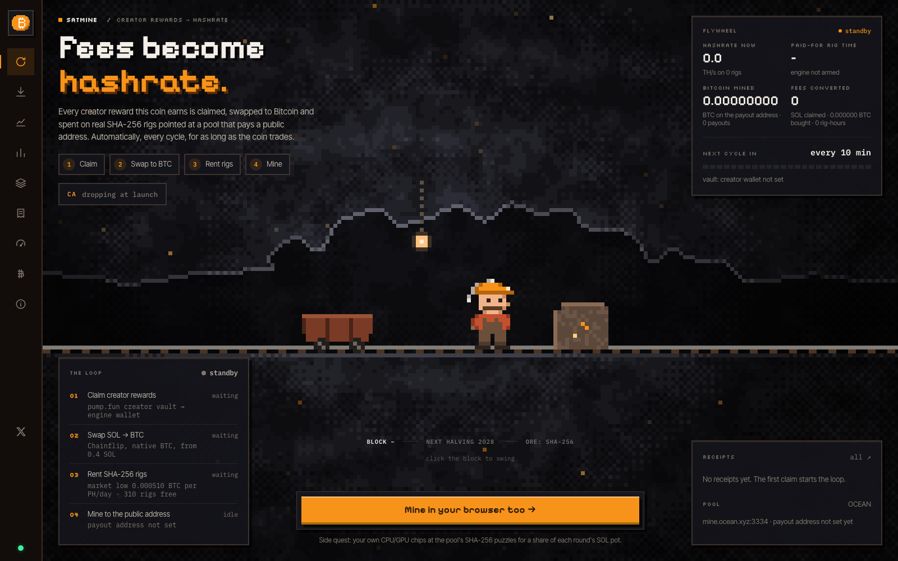
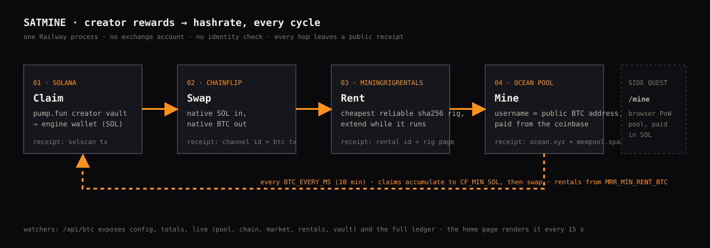
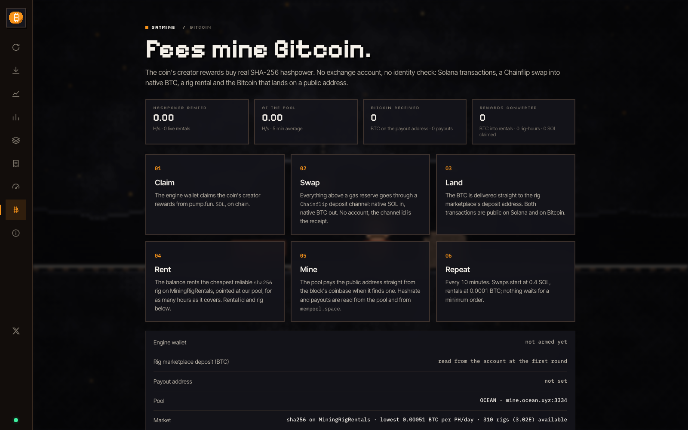
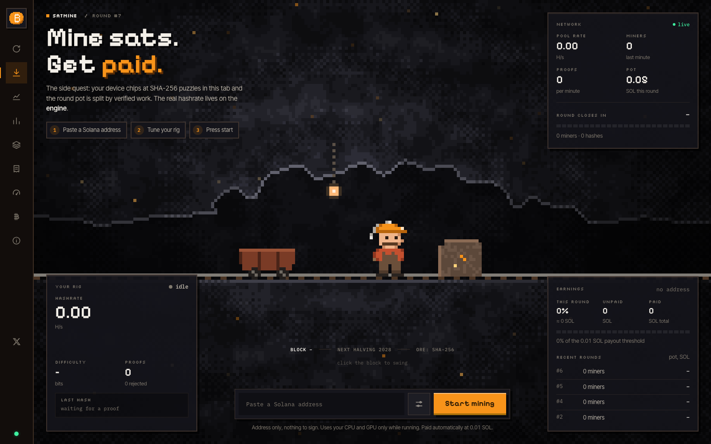

<p align="center">
  
</p>

<h1 align="center">Satmine</h1>

<p align="center"><b>Fees become hashrate.</b><br>
A pump.fun coin whose creator rewards are claimed, swapped to native Bitcoin and spent on real SHA-256 rigs, automatically, every cycle, for as long as the coin trades.<br>
No exchange account. Nothing held. A public receipt at every hop.</p>

<p align="center">
  <a href="https://satmine.vercel.app">satmine.vercel.app</a> ·
  <a href="https://satmine.vercel.app/bitcoin">live receipts</a> ·
  <a href="https://x.com/Satmine_Sol">@Satmine_Sol</a>
</p>

<p align="center">
  
</p>

---

## What it is

Most "revenue share" coins route fees back to holders or to a buyback. Satmine routes them into **Bitcoin mining**.

Every pump.fun coin pays its creator a share of trading fees. Satmine's engine wallet owns that creator position. On a timer it:

1. **claims** the creator rewards (SOL),
2. **converts** them on Solana (a Jupiter swap SOL → USDT, the currency NiceHash's SHA-256 market trades in),
3. **funds a standing hashpower order** on [NiceHash](https://www.nicehash.com): the USDT is deposited over the Solana network and refills one order on the `SHA256AsicBoost` market, pointed at our pool,
4. **mines** to a public Bitcoin address that the pool pays straight from the coinbase.

As long as people trade the coin, fees keep arriving and the order keeps getting refilled, so the hashrate is a continuous stream instead of one-off bursts. If fees stop, the order's budget runs out and the hashrate stops with it. Nothing is a subscription: hashpower on NiceHash is bought by the second at a price per EH/s per day, and the budget drains exactly as fast as rigs deliver.

The site shows all of it live: hashrate delivered to the order right now, how long the remaining budget lasts at that speed, Bitcoin landed on the payout address, and every transaction, deposit, order and refill with a link to where you can check it yourself.

<p align="center">
  
</p>

## Why this route

| Hop | Alternative we rejected | What we use | Why |
|---|---|---|---|
| Converting the SOL | Centralised exchange (custody, withdrawal delays) | **Jupiter** swap on Solana, SOL → USDT, in the engine wallet | One on-chain transaction, no account, the signature is the receipt. USDT is only a unit of account for the marketplace: it is deposited the same cycle and never held |
| Buying hashrate | Renting individual rigs (MiningRigRentals: unreliable rigs, per-rig minimums, rigs going offline mid-rental) | **NiceHash** standing order on the `SHA256AsicBoost` USDT market, refilled every cycle | One order, many rigs behind it; the marketplace pays only for accepted shares; the budget drains by the second, so hashrate follows fees instead of being bursty |
| Pool | Pools that pay from a pool wallet | **Ocean** (`mine.ocean.xyz:3334`), username = the public BTC address | Pays from the block's coinbase, so a payout is provably a mining reward, not a transfer |

NiceHash asks the buyer account for identity verification once; the engine's API key is read + marketplace only (no withdrawals). A no-KYC alternative, Chainflip (SOL → native BTC) plus MiningRigRentals rentals, is fully implemented behind `HASH_PROVIDER=mrr`.

## Receipts: how to verify it yourself

Nothing on the site needs to be trusted. Every step produces something a third party can open:

| Step | Receipt | Where |
|---|---|---|
| Claim | Solana transaction from the pump.fun creator vault to the engine wallet | [solscan.io](https://solscan.io) |
| Convert | Solana transaction of the Jupiter swap (SOL in, USDT out, same wallet) | [solscan.io](https://solscan.io) |
| Deposit | Solana transaction of the USDT transfer to the NiceHash deposit address shown on the site | [solscan.io](https://solscan.io) |
| Order | Order id, budget, price, accepted speed and rig count, from the NiceHash API, refreshed every minute | the site's receipts list and `GET /api/btc` |
| Rent | Rental id and the rig's public page (hashrate, price per PH/day, reliability score) | [rig.rent](https://www.miningrigrentals.com) |
| Mine | The payout address's hashrate at the pool; every coinbase payout to it on chain | [ocean.xyz/stats/\<address\>](https://ocean.xyz), [mempool.space/address/\<address\>](https://mempool.space) |

The engine wallet, the marketplace deposit address and the payout address are all printed on the `/bitcoin` page.

<p align="center">
  
</p>

## The side quest: mine in your browser

`/mine` is a browser proof-of-work pool, the original Satmine game. Your tab hashes `SHA-256(seed ‖ nonce)` on CPU (Web Workers) and GPU (WebGPU compute), looking for digests with `difficulty` leading zero bits. The server verifies each proof with a single hash, credits 2^difficulty hashes of work, and splits each round's SOL pot by share of verified work. Payouts are plain SOL transfers once a balance passes the threshold.

It is real work and real SOL, but it is not Bitcoin mining: a browser at a few MH/s is ~10 orders of magnitude short of a Bitcoin block. The Bitcoin hashrate is the engine's.

<p align="center">
  
</p>

Pages: **Engine** (home), **Mine**, Stats, Leaderboard, Rounds (with per-round split), Ledger, Benchmark, Bitcoin (full receipts), How it works.

## How the engine decides

Runs every `BTC_EVERY_MS` (10 min by default). Each cycle, in order:

| Step | Rule |
|---|---|
| Claim | If the creator vault holds ≥ `BTC_MIN_CLAIM_SOL`, claim it (both pump.fun programs). |
| Convert | SOL above `BTC_KEEP_SOL` (gas reserve) is swapped to USDT through Jupiter (1 % slippage cap) in the engine wallet. |
| Deposit | Any USDT balance ≥ `BTC_MIN_DEPOSIT_USDT` is transferred to the NiceHash USDT deposit address (Solana network), fetched once from the API and shown on the site. |
| Order | NiceHash's SHA-256 market needs 300 USDT to open an order (`NH_ORDER_MIN_USDT`); until the marketplace balance reaches that, the engine logs `waiting: x / 300 USDT`. The first order is placed at `NH_PRICE_MARGIN ×` the market price (3 % above, so rigs pick it up at once) with speed cap `NH_LIMIT_EH`, against a saved pool (`POOL_HOST:POOL_PORT`, username `BTC_ADDRESS.worker`). Every later cycle **refills the same order** with whatever balance is ≥ `NH_REFILL_MIN_USDT`. If the order dies (cancelled, expired), the next cycle opens a new one. |
| Watch | The live order (accepted speed, rigs, budget left), pool hashrate, on-chain payouts, the market price and the creator vault are refreshed every minute and served at `GET /api/btc`. "Paid-for time" on the site is budget ÷ (price × current speed). |

With `HASH_PROVIDER=mrr` the convert and order steps become a Chainflip swap into native BTC and MiningRigRentals rentals (extend the running rig first, otherwise rent the cheapest reliable one); see `engine/btc.js` for those rules.

`BTC_DRY=1` runs the whole loop but only logs what it would do (`would claim …`, `would swap …`, `would rent rig …`). That is how you arm it safely the first time.

## Run it

```bash
git clone https://github.com/openpumptrade/satmine && cd satmine
npm install
cp .env.example .env
npm start
```

Open http://localhost:8787. Out of the box:

- the browser pool runs **simulated** (every round pays a fixed pot into the ledger, no SOL moves);
- the engine is **off** (`BTC_ENGINE=0`) and the home page shows the public side only: market prices, pool, chain.

Set `CREATOR_WALLET` (public key, no secret) and the home page already shows how much SOL is waiting in the creator vault.

### Arming the engine

1. Create a [NiceHash](https://www.nicehash.com) account and an API key with wallet **view**, hashrate orders **view + manage** and **manage pools**. No withdrawal permissions: the engine never takes funds out.
2. Pick a fresh Bitcoin address for payouts (`BTC_ADDRESS`). This is public; it goes in the pool username.
3. Fill `NH_API_KEY`, `NH_API_SECRET`, `NH_ORG_ID`, `PRIVATE_KEY` (the coin's creator wallet), `BTC_ADDRESS`, `HASH_PROVIDER=nicehash`.
4. Start with `BTC_ENGINE=1 BTC_DRY=1` and read the logs for one cycle (`would swap …`, `would deposit …`, `would create order …`).
5. Set `BTC_DRY=0`.

### Going live with the browser pool

- `TOKEN_MINT`: the coin's CA, shown on the page with a pump.fun link.
- `TREASURY_SECRET` + `RPC_URL`: the server pays balances over `PAYOUT_THRESHOLD_SOL` with SOL transfers at each round close.

## Configuration

Everything is an environment variable; `.env.example` lists them all with comments.

| Group | Variables |
|---|---|
| Pool | `PORT`, `ROUND_MS`, `REWARD_SOL`, `PAYOUT_THRESHOLD_SOL`, `MIN_DIFFICULTY`, `TOKEN_MINT`, `TREASURY_SECRET`, `RPC_URL`, `DATA_FILE` |
| Engine | `BTC_ENGINE`, `BTC_DRY`, `BTC_EVERY_MS`, `HASH_PROVIDER` (`mrr` \| `nicehash`), `CREATOR_WALLET`, `PRIVATE_KEY`, `BTC_KEEP_SOL`, `BTC_MIN_CLAIM_SOL`, `BTC_DATA_FILE` |
| NiceHash (default provider) | `NH_API_KEY`, `NH_API_SECRET`, `NH_ORG_ID`, `NH_TEST`, `NH_ALGORITHM`, `NH_LIMIT_EH`, `NH_PRICE_MARGIN`, `NH_ORDER_MIN_USDT`, `NH_REFILL_MIN_USDT`, `BTC_MIN_DEPOSIT_USDT` |
| Chainflip (`HASH_PROVIDER=mrr`) | `CF_SLIPPAGE_PCT`, `CF_MIN_SOL` |
| MiningRigRentals (`HASH_PROVIDER=mrr`) | `MRR_API_KEY`, `MRR_API_SECRET`, `MRR_ALGO`, `MRR_MIN_RENT_BTC`, `MRR_RPI_MIN`, `MRR_HASH_MIN_TH`, `MRR_MAX_HOURS`, `MRR_MAX_PRICE_X`, `MRR_EXTEND_WINDOW_MIN` |
| Pool target | `BTC_ADDRESS`, `POOL_HOST`, `POOL_PORT`, `POOL_WORKER`, `POOL_NAME` |

## API

| Endpoint | What |
|---|---|
| `GET /api/btc` | The engine: `config`, `flow` (TH/s now, rigs, paid-for time, next cycle), `totals`, `live` (pool, chain, market, rentals, balance, vault), `ledger` (claims, swaps, rentals, errors) |
| `GET /api/stream` | Server-sent events: pool state every 2 s, `settled` and `payout` events |
| `GET /api/state`, `/api/stats`, `/api/rounds`, `/api/rounds/:id`, `/api/wallet/:addr`, `/api/bench` | Browser pool reads |
| `POST /api/challenge`, `POST /api/proof` | Browser pool: get a ticket, submit a nonce |

## Layout

```
server.js            the pool server + static hosting (zero-dependency node http)
engine/btc.js        the loop: claim → swap → rent → watch; dry-run; ledger; /api/btc view
engine/chainflip.js  Chainflip SDK wrapper: quote, deposit channel, status
engine/mrr.js        MiningRigRentals API v2 client: HMAC-SHA1 auth, balance, deposit address, pool profiles, rigs, rentals, extend
engine/nicehash.js   NiceHash client: HMAC-SHA256 auth, balance, deposit address, pools, orders, refill
public/              static frontend, no build step: app.js (routing + views), pit.js (pixel-art mine), miner.js + worker.js + gpu.js + sha.js (browser mining), charts.js, fx.js
vendor/pumpkit       Solana/pump.fun toolkit (creator vault claims, Jupiter swaps, transfers)
docs/                screenshots and the pipeline diagram
```

State persists to JSON files (`DATA_FILE`, `BTC_DATA_FILE`); on Railway they live on a mounted volume.

## Deploy

- **API**: Railway, one service running `node server.js`, a volume mounted at `/data` with `DATA_FILE=/data/state.json` and `BTC_DATA_FILE=/data/btc.json`.
- **Frontend**: Vercel from `public/` (its own `vercel.json` rewrites every non-API path to `index.html`). `public/config.js` reads `<meta name="satmine-api">` for the API origin.

## Security notes

- The engine wallet's secret and the marketplace keys live only in the host's environment. Nothing is committed.
- The engine never holds BTC: the pool pays the public address, which can be a wallet nobody at the project can spend from. USDT exists in the engine wallet only between the swap and the deposit, inside one cycle.
- The NiceHash API key has no withdrawal permission; a leaked key could at most buy more hashpower.
- The marketplace balance is the one custodial hop. Rentals are bought as soon as the balance allows, so it stays small.
- `/api/challenge` and `/api/proof` are rate-limited per wallet and per IP; proofs are bound to a ticket, a seed and a difficulty, and each nonce is accepted once.

## License

MIT
